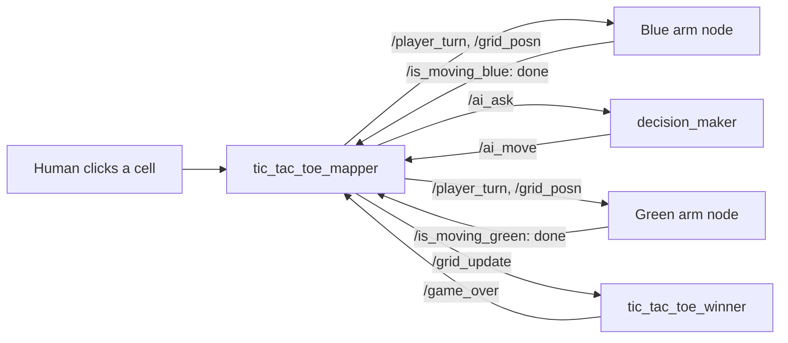

# Dual Franka Panda Tic-Tac-Toe — ROS 2, MoveIt 2, OpenCV

[](https://docs.ros.org/en/humble/)
[](https://moveit.picknik.ai/humble/)
[](https://gazebosim.org/docs/fortress)
[](https://opencv.org/)

Two Franka Emika Panda arms play tic-tac-toe in Gazebo by placing coloured cubes on a shared board. You play blue by clicking a cell; the AI plays green. Each move is carried out by a robot arm, an overhead camera shows the board, and a referee node draws the winning line or declares a tie.

I designed the board and cubes in Fusion 360 and built the description, controllers, MoveIt 2 configuration, vision, game logic and AI node.

## Demo

<table>
<tr>
<td align="center"><a href="https://youtu.be/3YFORZAgRXA"></a><br><sub><b>Human vs AI</b> — the current version</sub></td>
<td align="center"><a href="https://youtu.be/7btZoLp-t94"></a><br><sub><b>Human vs Human</b> — the earlier click-to-play version</sub></td>
</tr>
</table>

Build log on LinkedIn: [the idea](https://www.linkedin.com/posts/kumar-utkarsh-124aab227_robotics-ros2-opencv-ugcPost-7390068075070603264-xOhe/) (31 Oct 2025) · [both arms hovering over every cell](https://www.linkedin.com/posts/kumar-utkarsh-124aab227_robotics-ros2-moveit2-ugcPost-7390694157771714560-naJZ/) (2 Nov) · [moves commanded from the terminal](https://www.linkedin.com/posts/kumar-utkarsh-124aab227_robotics-ros2-moveit2-ugcPost-7391400845743046656-AVt-/) (4 Nov) · [click-to-play GUI](https://www.linkedin.com/posts/kumar-utkarsh-124aab227_robotics-ros2-opencv-ugcPost-7391835641292099584-77qh/) (5 Nov) · [AI opponent](https://www.linkedin.com/posts/kumar-utkarsh-124aab227_robotics-ros2-ai-ugcPost-7392438376219693056-w3oW/) (7 Nov) · [Instagram reel](https://www.instagram.com/reel/DavHfnBCBA4/)

## How a turn works



The mapper owns the turn order: it passes a move to an arm, waits for that arm's `is_moving` signal to go from true to false, and only then hands the turn over. Each arm node ignores moves that are not its colour, so the two arms never act at the same time.

## Key features

- **Two arms, one planning setup** — both Pandas are defined in one URDF and one MoveIt 2 configuration (`dual_panda.srdf`) with separate arm and gripper groups; each arm is driven by its own [pymoveit2](https://github.com/AndrejOrsula/pymoveit2) node.
- **Pick and place per move** — each arm picks the next of its five cubes and places it in the chosen cell (pre-grasp, grasp, lift, place, return home), running in a worker thread so callbacks stay responsive.
- **Vision and GUI** — an overhead Gazebo camera is cropped to the board; OpenCV HSV masks find the blue and green cubes and draw them on a 3 × 3 board that is also the click target.
- **AI opponent** — `decision_maker` asks Gemini 2.0 Flash for a move, then checks it: an invalid reply is rejected, and an immediate win or a block found by a rule check overrides it. If the API call fails, the rule check plays on its own.
- **Referee** — `tic_tac_toe_winner` tracks every move, detects all eight winning lines or a tie, draws the result and publishes `/game_over` to stop further moves.

## Software stack

ROS 2 Humble · MoveIt 2 · pymoveit2 · ros2_control · Gazebo Fortress (`ros_gz`) · OpenCV · cv_bridge · Gemini API · Python

## Packages

`panda_description` dual-arm URDF, board, cubes, camera · `panda_controller` arm and gripper controllers · `panda_moveit` MoveIt 2 config · `panda_vision` board mapper, referee, HSV tuning tool · `panda_ai` decision node · `panda_bringup` launch file · `pymoveit2` vendored library with the two arm nodes in `examples/`

## Run

```bash
# Ubuntu 22.04, ROS 2 Humble
mkdir -p ~/ttt_ws/src && cd ~/ttt_ws/src
git clone https://github.com/MechaMind-Labs/ROS2_Dual_Franka_Panda_TicTacToe_AI_Vision.git .
cd ~/ttt_ws && rosdep install --from-paths src --ignore-src -r -y
pip install google-generativeai
colcon build --symlink-install && source install/setup.bash

export GEMINI_API_KEY=your_key_here
ros2 launch panda_bringup pick_and_place.launch.py
```

Click a cell in the **Tic Tac Toe Board** window to play blue.

## Engineering notes

- **Taught poses, not visual grasping.** Cube pick-ups and the nine cell placements are stored joint configurations; the camera reads and displays the board but does not guide the grasp. Vision-guided placement is the natural next step, and the [SCARA cell](https://github.com/Curious-Utkarsh/ROS2_SCARA_WS) does vision-guided picking.
- **An LLM with guard rails.** A language model alone can return an illegal or weak move, so its answer is validated and overridden when a rule check finds a win or a necessary block.

## Related

- [Franka colour sorting](https://github.com/MechaMind-Labs/Franka_Panda_Color_Sorting_Robot) — single-arm vision pick-and-place that came before this
- [SCARA conveyor cell](https://github.com/Curious-Utkarsh/ROS2_SCARA_WS) — vision-guided picking on real hardware
- [UR5 gesture pick-and-place](https://github.com/MechaMind-Labs/UR5_PICK_AND_PLACE_MEDIAPIPE_ROS2) — teleoperated manipulation with MediaPipe

## Credits

[`pymoveit2`](https://github.com/AndrejOrsula/pymoveit2) by Andrej Orsula (BSD-3-Clause) is vendored in `pymoveit2/`. Franka Panda meshes follow the Franka Emika description.

---
[MechaMind Labs](https://www.mechamindlabs.com/) · [YouTube](https://www.youtube.com/@MechaMindLabs) · [LinkedIn](https://www.linkedin.com/company/mechamindlabs/)
